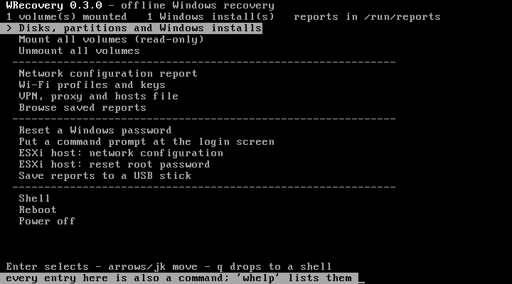
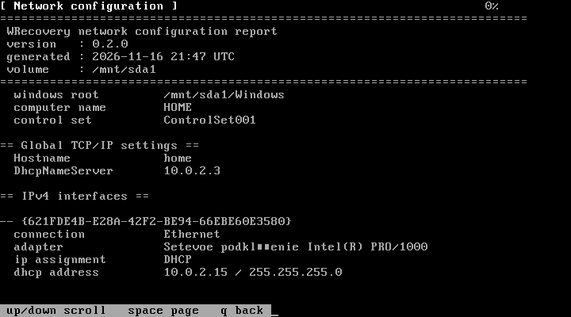

# WRecovery

**A ~5 MiB bootable ISO that mounts the disks of a dead **Windows** or **ESXi**
machine and gets the network configuration back out — plus the local account /
root password, if you are locked out.**

Boots on **UEFI and BIOS**, works on servers (PERC / Smart Array / LSI HBAs,
NVMe, virtio) and laptops (SATA, USB), needs no network, and mounts everything
**read-only** unless you explicitly ask otherwise.

[](https://github.com/rawnullbyte/WRecovery/actions/workflows/build.yml)




```
WRecovery 0.3.0 - offline Windows recovery
────────────────────────────────────────────────────────────
 1 volume(s) mounted   1 Windows install(s)   reports in /run/reports
 > Disks, partitions and Windows installs
   Mount all volumes (read-only)
   Unmount all volumes
   ──────────────────────────────────────────────────────────
   Network configuration report
   Wi-Fi profiles and keys
   VPN, proxy and hosts file
   Browse saved reports
   ──────────────────────────────────────────────────────────
   Reset a Windows password
   Save reports to a USB stick
   ──────────────────────────────────────────────────────────
   Shell
   Reboot
   Power off
```

## What it recovers

| | |
| --- | --- |
| **Interfaces** | friendly name, adapter model, GUID, `ControlSet` in use |
| **Static config** | IP, mask, gateway, DNS, DNS suffix, domain, WINS, MTU |
| **DHCP state** | `EnableDHCP`, DHCP address/server/gateway/DNS, lease times |
| **Wireless** | every WLAN profile: SSID, auth, encryption, **PSK passphrase** |
| **VPN** | `rasphone.pbk` entries: hostname, device, user, domain |
| **Proxy** | WinINET proxy server, bypass list, PAC URL |
| **Routing** | persistent static routes |
| **Identity** | computer name, Windows edition/build, registered owner |
| **hosts file** | non-comment entries |

`Windows.old` is scanned too, so a reinstall or downgrade does not lose the old
settings.

Everything lands in `/run/reports`:

```
network-<vol>.txt      readable report
network-<vol>.tsv      machine readable: context<TAB>field<TAB>value
restore-<vol>.cmd      netsh script that rebuilds the static configuration
wifi-<vol>/*.xml       WLAN profiles, importable with  netsh wlan add profile
```

## Quick start

```sh
git clone https://github.com/rawnullbyte/WRecovery
cd WRecovery
./build.sh                     # -> out/wrecovery-0.3.0.iso
```

Write it to a USB stick (the image is isohybrid, so this is all it takes):

```sh
sudo dd if=out/wrecovery-0.3.0.iso of=/dev/sdX bs=4M status=progress conv=fsync
```

…or attach the ISO through the BMC/IPMI virtual media, iDRAC, iLO, or a VM.

Build dependencies:

| distro | packages |
| --- | --- |
| Arch | `base-devel bc flex bison libelf openssl xorriso grub python3` |
| Debian/Ubuntu | `build-essential bc bison flex libelf-dev libssl-dev xorriso grub-pc-bin grub-efi-amd64-bin python3` |

`scripts/fetch-tools.sh` unpacks `xorriso` and `grub` into `.cache/tools` for
hosts where you cannot install packages. Everything else (kernel, busybox) is
downloaded into `.cache/` and verified against pinned sha256 sums.

First build takes a few minutes (the kernel is compiled), then seconds.

## Using it

The menu comes up on the VGA console. **Every menu entry is also a command**, so
you can ignore the menu completely: press `q` for a shell, or use the serial
console / SSH-less `ttyS0` (115200 8N1).

| command | what it does |
| --- | --- |
| `wdisks` | disks, partitions, filesystems, Windows installs |
| `wmount` | mount every Windows volume read-only |
| `wmount -w sdb1` | mount one volume read-write |
| `wmount -u` | unmount everything |
| `wnet` | recover network config from every mounted Windows install |
| `wnet /mnt/nvme0n1p3` | recover from one volume only |
| `wusb` | mount the first removable disk read-write |
| `wsave /mnt/sdb1` | copy the reports to a USB stick |
| `wfind '*.pbk'` | search all mounted volumes |
| `wpasswd` | list local Windows accounts |
| `wpasswd Administrator` | clear that account's password |
| `winreg` | offline registry reader/writer (`ls`, `values`, `get`, `dump`, `sam-users`, `sam-reset`) |
| `wretui` | start the menu by hand (e.g. from the serial console) |
| `whelp` | everything above, on one screen |

## The menu

The TUI is plain ANSI + termios — no ncurses, no terminfo, ~20 KiB of C. It
works on the VGA console, over serial, and through IPMI.

* `↑`/`↓` or `j`/`k` move, `Enter` selects, `q`/`Esc` leaves the menu.
* Every action runs the same shell command you could type yourself; output is
  shown in a scrollable pager (`space` page, `q` back).
* **`Shell`** (or `q`) leaves the menu and drops you into a login shell. Type
  `exit` there and the menu comes back.



## ESXi hosts

ESXi keeps its whole configuration in `state.tgz` on the FAT boot partition
(`BOOTBANK1`/`BOOTBANK2`) — nothing VMFS-specific is needed to read it:

```
wesxi                     # hostname, vmkernel IPs, DNS, NTP, vSwitches, iSCSI
wesxi --report            # ... and save it to /run/reports/esxi-<vol>.txt
wesxi --password          # clear the root password
```

Recovered from `etc/vmware/esx.conf`, `etc/resolv.conf`, `etc/ntp.conf`,
`etc/hosts` and `etc/shadow`:

| | |
| --- | --- |
| identity | hostname, domain, product |
| network | every `/net/...` setting: vmkernel NIC IP/netmask/MAC, portgroups, vSwitch uplinks, VLAN ids |
| DNS | nameservers and search domains |
| NTP | configured servers and restrictions |
| iSCSI | initiator name and targets |
| accounts | local users and whether they have a password |

`wesxi --password` writes a fresh `$6$` (SHA-512-crypt) hash for `root` into
`etc/shadow`, repacks `state.tgz`, keeps `state.tgz.bak-<timestamp>` next to it
and a copy in `/run/reports`, then verifies the new hash inside the tarball.
`wesxi --undo` puts the backup back.

An empty password means "no password" to PAM, so root logs in with an empty
password and you run `passwd` immediately. The hash generator
(`winreg cryptpw`) is verified against `openssl passwd -6` and passlib.

Note: only the FAT boot partition can be read — a host whose only copy of
`state.tgz` lives on a VMFS datastore is out of reach (no VMFS driver, and
VMFS is not something we can reimplement in 5 MiB).

## Resetting a Windows password

Locked out of a local account? The SAM hive is on the same disk:

```
wpasswd                       # list local accounts (RID, state, admin)
wpasswd Administrator         # clear it, enable + unlock the account
```

This is the technique ntpasswd/chntpw has used for 20 years:

* sets the LM and NT hash *lengths* in the account's `V` record to zero, which
  makes Windows treat the password as empty,
* clears the disabled flag and lockout counter in the `F` record and sets
  "password never expires",
* recomputes the hive's base-block checksum, which Windows validates on load,
* writes `SAM.bak-<timestamp>` next to the hive **and** into `/run/reports`
  before touching anything.

Then boot Windows, log in with an empty password, and set a new one.

Limits:

* **Microsoft accounts** (login is an e-mail) authenticate online — clearing the
  cached hash does not get you into the profile.
* The volume is remounted **read-write** for this operation only, after a
  confirmation.
* If `SAM.LOG1`/`SAM.LOG2` are non-empty the hive has unflushed changes and
  Windows replays that log on boot, which can undo the reset. Boot Windows once,
  shut it down cleanly, then retry.
* Syskey/StartupKey protected hives are out of scope.

## How it works

```
build.sh
 ├─ fetch + verify   kernel tarball, busybox tarball (sha256 pinned)
 ├─ build            winreg (static C), wretui, busybox, linux bzImage
 ├─ initramfs        busybox + scripts + tools -> cpio.gz (xz/gz)
 ├─ kernel           CONFIG_INITRAMFS_SOURCE embeds the initramfs
 └─ iso              GRUB BIOS eltorito.img + GRUB EFI in a FAT16 El Torito
                     partition, isohybrid MBR/GPT
```

* **One kernel file, both firmwares.** GRUB's `i386-pc-eltorito` image boots the
  kernel on BIOS; a GRUB `x86_64-efi` binary inside a small FAT image boots it
  on UEFI. The initramfs is built into the kernel, so there is no initrd to keep
  in sync and no `root=` to get wrong.
* **Small on purpose.** The kernel starts from `allnoconfig` plus an explicit
  list (`src/kernel.fragment`) — no modules, no DRM, no networking stack, only
  the storage controllers and the three filesystems that matter (NTFS3, exFAT,
  FAT). That is the difference between 7.7 MiB and 2.2 MiB of kernel.
* **Offline registry parsing.** `src/winreg.c` is a ~1100 line read-only (and
  SAM-writing) parser for the Windows `regf` format: cells, hbins,
  `nk`/`vk`/`lf`/`li`/`ri`, big-data values, UTF-16 strings, high-bit value
  types. No Windows, no `chntpw`, no Python in the image. It is
  differential-tested against
  [python-registry](https://github.com/williballenthin/python-registry) over
  ~49k values on every CI run.
* **Read-only by default.** All mounts are `ro`; only `wmount -w` and `wpasswd`
  ever write, and both ask first.

### Hardware support

Storage: AHCI/SATA, ATA, NVMe, USB storage, MMC/SD, virtio-blk/-scsi,
VMware PVSCSI, and the server HBAs that usually sit in front of the disks:
`megaraid_sas` (Dell PERC), `mpt3sas`/`mpt2sas` (LSI SAS2/SAS3, PERC H330/H730/
H740), `hpsa` (HP Smart Array), `aacraid`, `smartpqi`, `isci`.

Filesystems: **NTFS3** (read/write), exFAT, FAT12/16/32.

Input: PS/2 and USB HID keyboards. Console: VGA/framebuffer and serial
(`console=tty0 console=ttyS0,115200n8`).

## Tests

```sh
./tests/run-tests.sh
```

54 checks, all in QEMU:

* builds an NTFS volume with a real Windows `SYSTEM` hive, WLAN profile XMLs, a
  VPN phonebook and a hosts file, inside a partitioned disk image,
* boots the ISO on **BIOS**, on **UEFI** (OVMF) and with a **virtio** disk,
* asserts: disk mounted, interfaces parsed, static IP + friendly name
  recovered, Wi-Fi key recovered, DPAPI-protected key flagged, VPN host and
  hosts entries present, restore script contains the right `netsh` lines,
* drives the guest shell over the serial console: runs the menu, clears a
  Windows password with `wpasswd`, saves the reports to a second disk,
* host side: verifies the patched SAM with `python-registry` (hash lengths zero,
  account enabled, checksum valid) and compares `winreg` against
  `python-registry` for every key and value of the sample hive,
* checks that a USB keyboard driver is loaded (a regression test: it was
  missing once),
* ESXi: builds a boot partition with a `state.tgz`, checks the recovered
  hostname/IP/DNS/NTP/uplinks, clears the root password and verifies the new
  hash by regenerating it from its own salt, then restores the backup,
* Windows console-mode reset: swaps `sethc.exe` for `cmd.exe` and undoes it.

`tests/run-tests.sh --iso path/to.iso` reuses an existing ISO, `--no-uefi` skips
the UEFI pass.

## CI

`.github/workflows/build.yml`

* every push/PR: install deps, cache the kernel tree, `./build.sh --size-check`
  (fails above 10 MiB), run the full QEMU test suite, upload the ISO artifact,
* on a `v*` tag: attach the ISO and its sha256 to a GitHub release.

## Limitations

* **BitLocker** volumes are detected and reported but not unlocked (no
  `cryptsetup` in the image — it would not fit the size budget).
* **VMFS** is not supported: ESXi recovery works on the FAT boot partition,
  where ESXi keeps `state.tgz`.
* **DPAPI-protected Wi-Fi keys** are flagged, and the profile XML is exported so
  Windows can import it. Decrypting them offline needs the DPAPI master keys and
  the user's password.
* **Dynamic disks / Storage Spaces** are not assembled; basic and GPT disks are.
* **32-bit UEFI** is not supported (`BOOTX64.EFI` only).
* No network stack by design: data leaves the machine on a USB stick.

## Layout

```
build.sh                    one-command build
src/winreg.c                offline registry hive parser + SAM password reset
src/wretui.c                the menu (ANSI + termios, no ncurses)
src/kernel.fragment         minimal kernel config (allnoconfig base)
src/busybox.config          busybox config (static, no network applets)
src/rootfs/init             PID 1
src/rootfs/lib/wrecovery.sh mount/scan/report helpers
src/rootfs/bin/w*           wdisks wmount wnet wpasswd wsave wfind wusb winstall whelp
scripts/mkfat.py            FAT12/16 image builder (El Torito EFI boot image)
scripts/mkinitramfs.py      cpio.gz builder with static /dev nodes
scripts/mkdiskimg.py        MBR/GPT test disk builder
scripts/fetch-tools.sh      rootless xorriso/grub fetch
tests/run-tests.sh          end-to-end BIOS/UEFI/virtio tests
tests/mkhive.py             registry hive writer for fixtures
tests/mksam.py              synthetic SAM hive (accounts, groups)
tests/mkstatic.py           synthetic SYSTEM hive with a static IP
tests/mkesxi.py             synthetic ESXi boot partition (state.tgz)
tests/test-sam.py           verifies a patched SAM with python-registry
```

## License

MIT. Registry hive layout knowledge comes from the
[Windows registry file format specification](https://github.com/msuhanov/regf)
and the long-standing `chntpw`/`ntpasswd` reference implementation; the
password-reset constants and the "clear the hash lengths" technique are theirs.